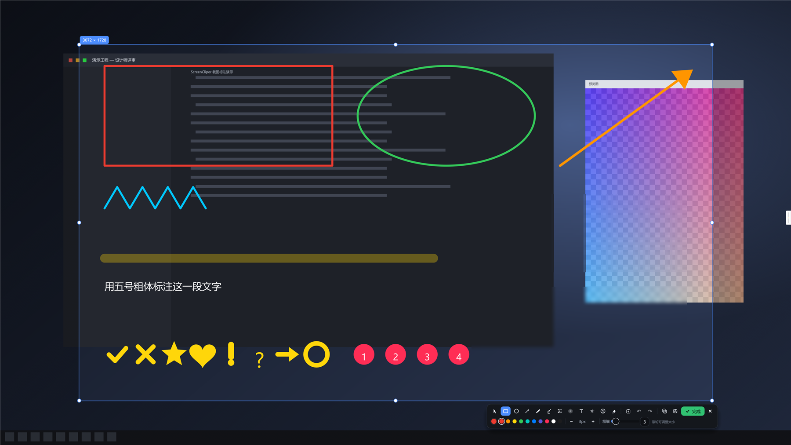
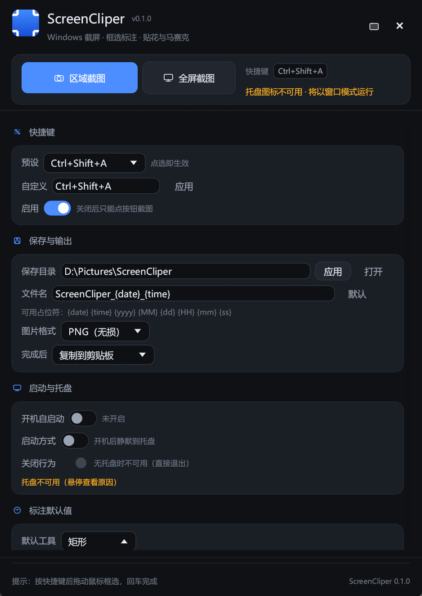
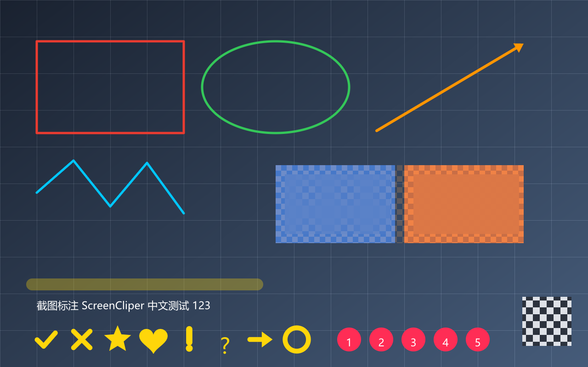

# ScreenCliper

> 一款用 **纯 Rust** 编写的 Windows 截图标注工具：框选截图、画笔涂鸦、贴花盖章、马赛克打码、开机自启动。

界面全部由 Rust 实现（`egui`/`eframe`），不依赖任何 C++/Electron 运行时；截屏使用 `xcap`，
标注渲染使用自研的软件光栅化引擎，**所见即所得**（屏幕上看到的预览与导出的 PNG 逐像素一致）。

---

## 功能特性

### 截图
- **区域框选**：全屏冻结画面 + 十字线 + 放大镜（含坐标与像素颜色读数），拖动即选
- **全屏截图**：一键选中整屏，仍可再调整选区
- **选区编辑**：8 个手柄缩放、拖动整体移动、实时显示尺寸
- **多显示器**：自动截取鼠标所在的那块屏幕，并按该屏幕 DPI 精确映射坐标
- **全局快捷键**：默认 `Ctrl+Alt+A`（可换成 `Ctrl+Shift+A`、`F1`、`PrintScreen` 等）

### 标注（全部支持任意颜色与粗细）
| 工具 | 说明 |
| --- | --- |
| 矩形 / 椭圆 | 拖拽绘制，抗锯齿描边 |
| 箭头 | 自动按长度缩放箭头头部 |
| 画笔 | 自由绘制，圆角连接，不透明 |
| 荧光笔 | 半透明宽笔触，叠加处不会重复加深 |
| 马赛克 | 框选区域按块取均值打码 |
| 模糊 | 多次盒式模糊，柔和脱敏 |
| 文字 | 点击输入，支持中文 |
| **贴花** | 8 种矢量贴花（对勾/叉号/星星/爱心/感叹/问号/箭头/圆圈），滚轮调大小 |
| 序号 | 递增数字徽章，适合写步骤说明 |
| 贴图 | `Ctrl+V` 把剪贴板图片贴进选区（等比缩放） |
| 橡皮 | 点击删除整个图形对象 |

- **撤销/重做**：`Ctrl+Z` / `Ctrl+Y`，右键快速撤销
- **导出**：`Ctrl+C` 复制到剪贴板、`Ctrl+S` 保存文件、回车按配置完成
- 支持 PNG（无损）与 JPEG（可调质量），文件名模板可自定义

### 常驻与设置
- 系统托盘菜单（截图 / 全屏截图 / 显示主窗口 / 打开保存目录 / 退出）
- **开机自启动**开关：写入 `HKCU\Software\Microsoft\Windows\CurrentVersion\Run`，**无需管理员权限**
- 关闭窗口可最小化到托盘，启动时可静默到托盘
- **自绘 UI 设计系统**：卡片式设置界面、iOS 风格开关、分段控件、手绘矢量图标（不依赖图标字体），
  深色 / 浅色两套配色，全部中文

---

## 界面预览

标注编辑器（框选后出现工具栏，选区外自动变暗）：



设置主窗口：



> 上面两张截图是在**受限的自动化会话**里生成的，所以设置页会出现「托盘图标不可用 / 无法写入注册表」
> 的提示（该会话禁止通知区图标与 HKCU 写入）。正常桌面双击运行不会出现这两条提示。

渲染引擎自检（`--selftest` 生成的全部图元）：



---

## 快速开始

### 环境要求
- Windows 10 / 11（x64）
- 编译需要 [Rust 工具链](https://rustup.rs)（MSVC 目标）与 Visual Studio Build Tools 的 C++ 生成工具

### 构建

```powershell
cargo build --release
# 产物：target\release\screen-cliper.exe
```

嫌麻烦可以直接用仓库里的脚本（会自动挑选系统 Rust 或仓库内便携工具链）：

```powershell
.\build.ps1                 # 构建 release
.\build.ps1 -Test           # 跑单元测试
.\build.ps1 -Profile debug -SelfTest   # 构建 debug 并输出渲染自检图
```

> **可选：离线/受限网络构建**
> 如果 `cargo` 无法直连 crates.io（例如受限环境下 Windows Schannel 不可用，
> 报 `SEC_E_NO_CREDENTIALS`），可以用一个本地源代理绕过：由 Node 承担 TLS，
> cargo 走 `sparse+http://127.0.0.1:47823/`。相关文件不纳入版本控制：
> - `.toolchain\cargo-proxy.js`：本地 crates.io 代理
> - `.toolchain\cargo\config.toml`：`[source.crates-io]` 源替换配置
>
> 正常联网的机器上无需以上内容：删掉 `.toolchain` 目录（或其中
> `cargo/config.toml` 的 `[source.*]` 两段）即可使用默认源。

### 运行

```powershell
# 启动主窗口（同时注册全局快捷键与托盘图标）
.\target\release\screen-cliper.exe

# 开机自启动时会带 --minimized，直接静默到托盘
.\target\release\screen-cliper.exe --minimized
```

按 `Ctrl+Alt+A`（或点击「区域截图」）→ 拖拽框选 → 用工具栏标注 → 回车完成（默认复制到剪贴板）。

### 命令行参数

| 参数 | 说明 |
| --- | --- |
| （无） | 启动主窗口 |
| `--minimized` | 启动后隐藏主窗口（供开机自启动使用） |
| `--version` / `--help` | 版本 / 帮助 |
| `--autostart on\|off\|status` | 命令行操作开机自启动注册表项 |
| `--capture <out.png>` | 直接把当前鼠标所在显示器截到文件（诊断用） |
| `--clipboard <png>` | 把一张图片写入剪贴板（诊断用） |
| `--synth <out.png>` | 生成一张合成桌面图（文档截图 / 无隐私素材用） |
| `--selftest <dir>` | 离屏渲染自检，输出标注示例图（无需显示器交互） |
| `--overlay <png> --monitor x,y,w,h --scale s [--full] [--status f] [--demo]` | 内部使用：全屏框选标注覆盖层 |

---

## 架构设计

```
screen-cliper.exe                 常驻控制进程
  ├─ egui 设置窗口（深/浅色）
  ├─ global-hotkey 全局快捷键
  ├─ tray-icon 托盘菜单
  └─ 捕获工作线程 ──赢──▸ screen-cliper.exe --overlay <png>
                         短命标注进程
                           ├─ 全屏无边框窗口 + 捕获图
                           ├─ 框选 / 标注交互
                           └─ 光栅化导出 → 剪贴板 / 文件 → 退出
```

几个关键设计取舍：

1. **覆盖层是独立进程**。控制窗口必须在抓屏前隐藏，否则会把自己截进图里；独立进程让两个窗口
   各自拥有干净的事件循环，也避免了多视口（viewport）带来的复杂性。
2. **隐藏/恢复窗口直接用 Win32 `ShowWindow`**，而不是 `ViewportCommand::Visible`。
   窗口被隐藏后 UI 事件循环可能不再推进，用 Win32 从工作线程恢复才能保证程序不会“消失”。
3. **预览就是导出结果**。编辑器只渲染“选区矩形”这一块，把同一份 `Shapes` 列表交给同一个光栅化器，
   因此屏幕上看到的像素与保存/复制的图片完全一致，不存在“预览和导出不一致”的经典问题。
4. **覆盖率遮罩统一合成**。所有图元先画到 f32 覆盖率遮罩（多边形用 4 条子扫描线做抗锯齿），
   再一次性合成，因此半透明荧光笔在自身重叠处不会变深。
5. **马赛克/模糊总是采样原始截图**，而不是已绘制的像素，符合“反复修改仍然正确”的直觉。

### 目录结构

```
src/
  main.rs       命令行分发：主窗口 / 覆盖层 / 抓屏 / 自检
  control.rs    设置窗口、托盘、快捷键、截图编排
  design.rs     设计系统：配色、卡片、按钮、开关、分段控件
  icons.rs      手绘矢量图标（工具、操作、状态）
  overlay.rs    全屏框选 + 标注编辑器 UI
  raster.rs     软件光栅化引擎（线段/多边形/文字/马赛克/模糊/贴花）
  shapes.rs     文档模型：工具、贴花、图形
  capture.rs    屏幕捕获（xcap）
  config.rs     配置读写、路径模板、图片编码
  autostart.rs  注册表 Run 键
  hotkey.rs     快捷键解析/格式化
  fonts.rs      Windows 中文字体加载（egui + 光栅化共用）
  icon.rs       程序化生成的图标
  applog.rs     运行日志
  selftest.rs   离屏渲染自检
  tray.rs       托盘图标与菜单
  win.rs        Win32 FFI（DPI、光标、窗口显隐、注册表外的系统交互）
```

---

## 数据位置

| 内容 | 路径 |
| --- | --- |
| 配置 | `%APPDATA%\ScreenCliper\config.json` |
| 日志 | `%APPDATA%\ScreenCliper\app.log` |
| 临时截图 | `%APPDATA%\ScreenCliper\temp\`（用后即删） |
| 默认保存目录 | `图片\ScreenCliper\` |

设置界面里可直接「打开配置目录」「打开日志」。
把环境变量 `SCREEN_CLIPER_HOME` 指向别处，可让配置与临时文件落在指定目录（便于便携使用或测试）。

---

## 已知限制

- **仅 Windows**：使用了 Win32 的 DPI、光标、窗口与注册表 API。
- **一次只截一块屏幕**：截取鼠标所在显示器；跨屏拼接暂未实现。
- **托盘依赖资源管理器**：在没有 Explorer 外壳的会话里（部分远程/服务会话）创建托盘图标会被系统拒绝，
  程序会自动降级为纯窗口模式并把原因写进日志。
- **开机自启动写 HKCU**：当前用户生效；若系统策略禁止写 Run 键会给出明确的错误提示。

---

## 开发与验证

```powershell
cargo test                       # 13 个单元测试：光栅化、配置、快捷键
cargo run -- --selftest out      # 生成图元自检图，肉眼检查渲染质量
cargo run -- --capture shot.png  # 验证抓屏与 DPI 处理
$env:SC_AUTO_SHOT_MS=1500; cargo run   # 启动 1.5s 后自动触发一次截图，验证「隐藏→抓屏→覆盖层→恢复」链路
```

`--demo` 会在覆盖层里预置一个选区与全部图元，用于在没有鼠标输入的环境下检查编辑器外观。
